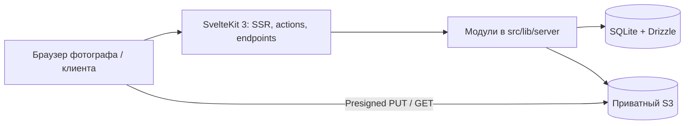

# Целевая архитектура Viewport

Это план будущей реализации. Сейчас в репозитории только минимальный SvelteKit-шаблон: без авторизации, БД, миграций и бизнес-модулей.

Viewport — учебный MVP передачи фотографий за восемь недель. Один Node.js процесс обслуживает SSR, hydration, формы, HTTP endpoints, работу с SQLite и внешним приватным S3. Масштабирование после MVP вне scope.

## Слои и модули

| Слой                | Расположение                                                         | Ответственность                           |
| ------------------- | -------------------------------------------------------------------- | ----------------------------------------- |
| Presentation        | `src/routes`, `src/lib/components`                                   | SSR, формы, отображение, взаимодействие   |
| Application         | `src/lib/server/auth`, `galleries`, `photos`, `sharing`, `downloads` | Авторизация, lifecycle, обработка, доступ |
| Data/infrastructure | `src/lib/server/db`, `storage`                                       | SQLite, транзакции, S3                    |

Routes не содержат SQL и сложную бизнес-логику. Отдельный REST API для CRUD не вводится: используются load и actions. Endpoints нужны для auth, загрузки/подтверждения и бинарных ответов.

## Адаптация к актуальному стеку

По уточнению используются последние совместимые стабильные версии. SvelteKit 3 переместил конфигурацию в `vite.config.ts`, заменил `$lib` на subpath import `#lib` и `$app/environment` на `$app/env`; исходная структура `src/lib/server` сохранена. TypeScript 6 — последняя совместимая ветка, хотя npm latest уже 7. Подробности: [versions.md](versions.md).

При будущей реализации `ORIGIN` потребуется передавать в `paths.origin` на этапе build и в Better Auth при runtime. Это следствие API SvelteKit 3; смена домена требует пересборки. Конфигурация не отключает CSRF.

## Данные

SQLite хранит `users`, `sessions`, `accounts`, `verifications`, `galleries`, `photos`, `upload_reservations`. Better Auth будет подключён через явное сопоставление таблиц Drizzle. Drizzle schema и DDL предстоит создать в VP-002; сейчас drizzle/ пуст.

- Gallery: `draft | published`; тема `light | dark`; уникальный nullable share token до публикации.
- Photo: `pending | processing | ready | failed`; nullable preview до обработки; MIME только JPEG/PNG/WebP; размер > 0.
- Reservation: `reserved | completed | released | expired`; одна запись на photo; срок в timestamp_ms.
- Даты — UTC с точностью до миллисекунд. Размеры — целые байты.
- В будущей схеме следует предусмотреть width, height и previewSizeBytes: размеры сетки и фактические затраты S3.
- Обложка проверяется сервисом: ready photo той же галереи. Прямой циклический foreign key cover → photo не вводится.
- Foreign keys для данных с объектами S3 используют RESTRICT: каскадное удаление не должно молча оставлять объекты. Удаление реализуется сервисом с компенсацией.

## Загрузка и квоты — целевое поведение

1. Авторизованный владелец draft отправляет метаданные партии.
2. В `BEGIN IMMEDIATE`: проверить доступ/статус, вычислить ready original bytes + активные reservations, атомарно создать pending photos и резервы. Для MVP квота одна на пользователя из env.
3. После commit выдавать короткоживущие presigned PUT. Ключи генерирует сервер: `users/{userId}/galleries/{galleryId}/originals/{photoId}`.
4. Браузер загружает напрямую. Bucket CORS разрешает только нужные origins, методы и заголовки.
5. Confirm проверяет владельца резерва, срок, HEAD, фактический размер и декодирование Sharp. Content-Type клиента недостаточно.
6. Ограничить число одновременных загрузок, размер партии, количество ожидающих обработок и декодируемых пикселей. Переполнение возвращает retryable отказ, без бесконечной очереди в памяти.
7. Sharp с ограничением concurrency/пикселей создаёт WebP, учитывает EXIF orientation, не изменяет оригинал. Превью без приватных метаданных.
8. В короткой транзакции повторно проверить draft и ownership, записать ready и закрыть резерв ровно один раз. Повтор confirm идемпотентен.
9. При ошибке/отмене/истечении выполнить повторяемую компенсацию SQLite+S3. Оригинал и превью учитываются раздельно: квота по исходникам, реальный S3 расход больше квоты.

Presigned PUT сам по себе не гарантирует размер объекта. Квота защищает принятые фотографии; дополнительная защита S3 — короткий TTL, ограничения партии, очистка неожиданных объектов. Требование жёсткого лимита на сам PUT потребует отдельного решения (например, presigned POST policy).

Никакого отдельного воркера: обработка после confirm в том же процессе, ограниченная очередь; очистка запускается короткими порциями при upload-операциях и отдельной CLI командой того же приложения для восстановления после простоя. Истёкшие записи не считаются пригодными к confirm; освобождение и удаление согласовываются идемпотентно.

## Публикация и доступ

Публикация требует хотя бы одной ready photo, валидной обложки и отсутствия активных загрузок. Токен — `randomBytes(32).toString('base64url')`, уникальность защищена SQLite. Published блокирует загрузку, удаление, сортировку и смену обложки. Сначала unpublish.

`/g/{token}` без регистрации показывает только published. Неизвестный, снятый и чужой token/photo — одинаковый 404. Каждый endpoint скачивания повторяет проверку. После unpublish уже выданные S3 GET остаются действительны до TTL; это известное ограничение временных URL, а не немедленный отзыв файлов. Страницы и ответы с приватными ссылками не кэшируются как публичные.

## Скачивание

Оригинал — redirect на короткоживущий подписанный S3 GET с безопасным Content-Disposition. ZIP — Archiver + S3 streams, без сохранения файла и без полного буфера. Контролируются суммарный объём, количество фото, число активных архивов, backpressure, обрывы клиента и ошибки S3. Имена очищаются от путей и разделителей, дубликаты разрешаются суффиксом. Published обеспечивает стабильный состав во время выдачи архива.

## Развёртывание

Один контейнер Node 24, SQLite volume, внешний S3, HTTPS на reverse proxy хостинга. Миграции до старта; `/health` проверяет доступность мигрированной SQLite, S3 на старте не требуется. Контейнер запускается пользователем node. Инструкция: [deployment.md](deployment.md).

## Граница текущего каркаса

Реализован минимальный SvelteKit dev-сервер; для локальной разработки отдельно запускается SeaweedFS mini из Compose. Auth, SQLite, миграции, галереи, интеграция приложения с S3, загрузки и скачивания находятся в backlog.
