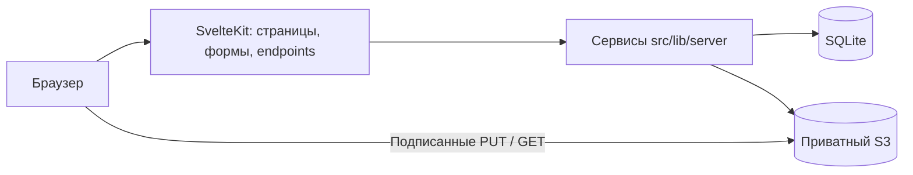

# Архитектура Viewport

Viewport — сервис передачи фотографий от фотографа клиенту. Один Node.js процесс обслуживает страницы, формы, HTTP endpoints, SQLite и приватное S3-хранилище.

## Модули

| Расположение               | Ответственность                                                         |
| -------------------------- | ----------------------------------------------------------------------- |
| `src/routes`               | Страницы, load, server actions и HTTP endpoints                         |
| `src/lib/components`       | Компоненты интерфейса                                                   |
| `src/lib/server/auth`      | Better Auth, cookie-сессии и requireUser                                |
| `src/lib/server/db`        | Drizzle schema, SQLite и атомарные транзакции                           |
| `src/lib/server/galleries` | Владение, настройки, обложка, порядок, публикация и доступ к оригиналам |
| `src/lib/server/photos`    | Квота, резервирование, confirm, Sharp и очистка                         |
| `src/lib/server/storage`   | AWS SDK, операции S3 и подпись URL                                      |

Routes вызывают серверные сервисы. Для редактирования используются server actions; отдельный REST CRUD API не вводится. Серверные модули не импортируются в клиентский код.

## Данные

SQLite работает с WAL, включёнными внешними ключами и busy timeout. Схема находится в `src/lib/server/db/schema.ts`, SQL и metadata миграций — в `drizzle/`. Миграции применяются до запуска HTTP-сервера.

- `users`, `sessions`, `accounts`, `verifications` — таблицы Better Auth.
- `galleries` — владелец, название, описание, тема, статус `draft | published`, обложка и уникальный nullable token.
- `photos` — статус `pending | processing | ready | failed`, имя, MIME, размер оригинала, ключи временного объекта/оригинала/превью, размер превью, его width/height и позиция.
- `upload_reservations` — размер, срок, статус `reserved | completed | released | expired` и отметка успешной очистки `cleanedAt`.

Даты хранятся в UTC с точностью до миллисекунд, размеры — целыми байтами. CHECK constraints ограничивают значения и запрещают ready без метаданных превью. Обложка проверяется сервисом: это ready photo той же галереи. Внешние ключи для объектов S3 не используют каскадное удаление.

## Авторизация и владение

Better Auth использует Drizzle adapter и cookie-сессии. Hook заполняет locals; каждый защищённый load/action/endpoint повторяет проверку сессии и владельца. Чужой ресурс возвращает 404. Изменение настроек и состава разрешено только в draft.

`ORIGIN` задаёт `paths.origin` при сборке и baseURL Better Auth при запуске. При смене origin требуется пересборка. CSRF-проверки включены. Политика referrer — `same-origin`: обычные HTML-формы сохраняют Origin, а внешние S3-запросы не получают referrer.

## Загрузка и обработка

1. Владелец draft отправляет метаданные файлов.
2. В `BEGIN IMMEDIATE` сервер проверяет доступ, статус и лимиты. Квота считается как ready original bytes + reserved bytes; pending photos и reservations создаются атомарно.
3. После commit сервер выдаёт PUT URL для временных ключей `users/{userId}/galleries/{galleryId}/uploads/{photoId}`. Сбой подписи переводит фотографии в failed и освобождает резервы.
4. Браузер загружает файлы напрямую в S3. Загрузчик ограничивает число одновременных передач и показывает прогресс.
5. Confirm проверяет владельца, draft, срок резерва, HEAD и фактический размер GET. Атомарный переход в processing исключает повторную обработку одного фото.
6. Sharp распознаёт содержимое JPEG/PNG/WebP, ограничивает пиксели, учитывает EXIF-ориентацию и создаёт WebP-превью без приватных метаданных. Обработка ограничена числом активных операций; при перегрузке сервер возвращает 429, без фоновой очереди.
7. Сервер сохраняет неизменённый оригинал в `originals/{photoId}`, а превью — в `previews/{photoId}.webp`. Браузерный PUT не имеет доступа к принятым оригиналам, поэтому повтор временной ссылки не перезаписывает их.
8. Короткая транзакция повторно проверяет draft, processing и резерв, записывает ready и completed. Первая фотография становится обложкой. Повтор confirm для ready не создаёт новую обработку и не удваивает квоту.

Сетевые операции выполняются вне SQLite-транзакций. Presigned PUT не ограничивает фактический размер передаваемого объекта: размер и содержимое проверяются до принятия. Квота учитывает оригиналы; временные объекты и превью увеличивают фактический расход S3.

## Ошибки и очистка

При ошибке или отмене photo переходит в failed, резерв — в released. Повтор такой загрузки создаёт новый photo. Ключи сохраняются до очистки, поскольку старый PUT URL может ещё действовать.

Очистка выбирает истёкшие reservations порциями: удаляет временные объекты, а для неготовых фото — также оригинал и превью. `cleanedAt` записывается после успешного удаления. При отказе S3 запись остаётся доступной для повтора. Зависший после рестарта processing очищается по TTL.

Очистка запускается перед presign и отдельной CLI. Внутри приложения она пропускает активные confirm; CLI запускается при остановленном приложении. Команды — в [deployment.md](deployment.md).

## Публикация и скачивание

Публикация атомарно проверяет наличие ready photos, корректную обложку и отсутствие reserved uploads. Токен генерируется через `randomBytes(32).toString('base64url')`; уникальность защищена SQLite. Published блокирует редактирование. Unpublish переводит галерею обратно в draft.

`/g/{token}` доступен без регистрации и показывает только published gallery с ready photos. Неизвестный токен и снятая публикация дают 404. Публичные page data не содержат email владельца и внутренних ключей объектов.

`/api/downloads/{token}/{photoId}` при каждом запросе проверяет token, published, ready и принадлежность фото, затем перенаправляет на GET URL оригинала с безопасным Content-Disposition. Срок подписанного GET — 120 секунд. Unpublish закрывает новые запросы, но не отзывает уже выданные S3 URL до истечения TTL. Страницы и ответы с подписанными ссылками не кэшируются публично.

## Развёртывание

Compose запускает приложение и SeaweedFS с отдельными SQLite/S3 volumes. Внутренний `S3_ENDPOINT` используется для серверных операций, `S3_PUBLIC_ENDPOINT` — для подписи браузерных ссылок. Приложение работает пользователем node; перед стартом выполняются миграции и настройка bucket/CORS. `/health` проверяет доступность таблиц SQLite.

Инструкции запуска — в [deployment.md](deployment.md), команды проверок — в [verification.md](verification.md), план дальнейших изменений — в [backlog](../tasks/README.md).
